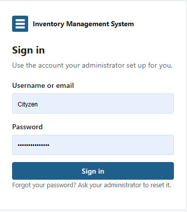
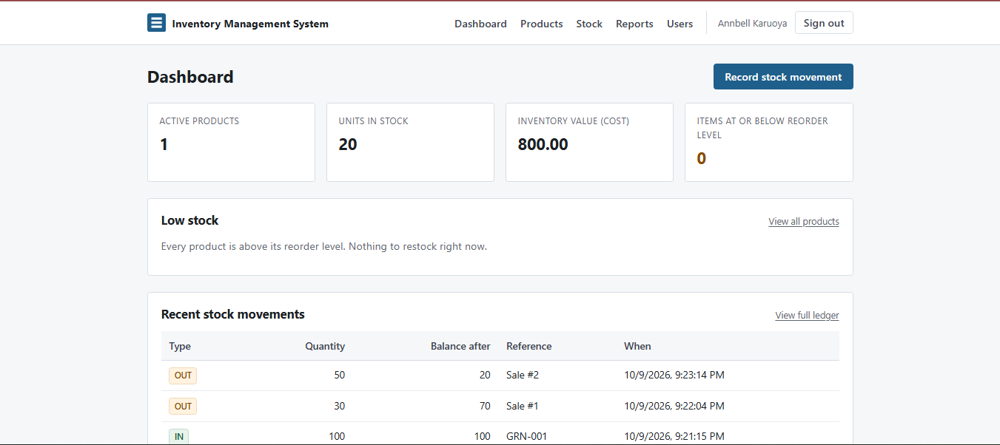
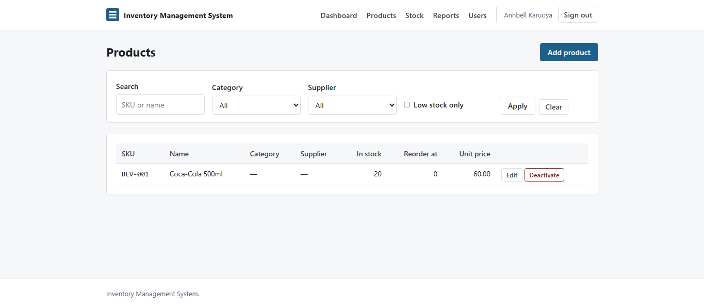
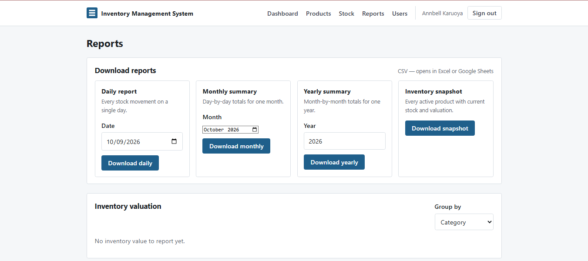
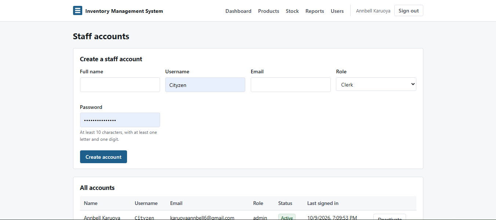

# Inventory Management System

> Web-based stock tracking for small-scale vendors.


Academic project developed at **JKUAT**. A web application that lets small-scale
vendors track stock, manage products, record stock movements, and generate
downloadable reports.

## Overview

The system pairs a Python/FastAPI backend with MySQL for relational storage and a
plain HTML/CSS/JS frontend. It covers full CRUD across products, categories, and
suppliers; a stock ledger that prevents overselling via row-level locking; role-based
access control; an audit trail; and five automated reports with CSV download.

It was presented to a JKUAT lecturer panel and received positive feedback on both
functionality and code quality.

## Features

- **Authentication** — JWT in HttpOnly cookies, bcrypt password hashing, CSRF
  protection, rate-limited login
- **Role-based access** — three roles (admin / manager / clerk) with server-side
  authorization on every endpoint
- **Product management** — CRUD with SKU uniqueness, category and supplier linking,
  per-product low-stock threshold
- **Stock ledger** — append-only `stock_transactions` table; `IN`, `OUT`, and
  `ADJUSTMENT` movements; row-level locking prevents concurrent overselling
- **Moving-average cost** — automatically recalculated on stock-in
- **Low-stock alerts** — dashboard card, filterable list, shortfall column
- **Automated reports** —
  - Dashboard summary (products, units, cost/retail value, margin)
  - Low stock by product
  - Inventory valuation grouped by category or supplier
  - Stock movement by date range
  - Daily / monthly / yearly CSV downloads
  - Full inventory snapshot CSV
- **Audit trail** — every create, update, deactivate, and stock movement writes an
  `audit_logs` row
- **Admin user management** — create, deactivate, and change roles

## Tech stack

| Layer | Technology |
|---|---|
| Backend | Python 3.12, FastAPI, SQLAlchemy 2.0 |
| Database | MySQL 8.0 (InnoDB) |
| Auth | PyJWT, bcrypt, slowapi |
| Frontend | HTML, CSS, vanilla JavaScript |
| Templates | Jinja2 |
| Dev tools | Uvicorn, Swagger UI |

## Screenshots

| Login | Dashboard |
|---|---|
|  |  |

| Products | Stock movements |
|---|---|
|  |  |

| Reports | Users |
|---|---|
|  |  |

*(Add the screenshots under `docs/screenshots/` before pushing.)*

## Getting started

### Prerequisites

- Python 3.12
- MySQL 8.0
- pip

### Install

```bash
git clone https://github.com/YOUR-USERNAME/inventory-management-system.git
cd inventory-management-system
python -m venv venv
source venv/bin/activate          # Windows: venv\Scripts\activate
pip install -r requirements.txt
```

### Database

```bash
mysql -u root -p -e "source database/schema.sql"
mysql -u root -p -e "CREATE USER 'ims_user'@'localhost' IDENTIFIED BY 'change-me'; GRANT SELECT, INSERT, UPDATE, DELETE ON inventory_db.* TO 'ims_user'@'localhost'; FLUSH PRIVILEGES;"
```

### Environment

```bash
cp .env.example .env
python -c "import secrets; print(secrets.token_urlsafe(64))"
```

Paste the generated key into `SECRET_KEY=` in `.env`, and set `DB_PASSWORD` to match
the MySQL user you created.

### Seed the first administrator

```bash
python scripts/init_db.py
```

### Run

```bash
uvicorn app.main:app --reload --port 8000
```

Open http://localhost:8000/login.

## Project structure

```
inventory-management-system/
├── app/
│   ├── main.py              # App factory, middleware, exception handlers
│   ├── config.py            # Typed settings from environment
│   ├── database.py          # Engine + session factory
│   ├── models.py            # SQLAlchemy 2.0 models
│   ├── schemas.py           # Pydantic request/response models
│   ├── security.py          # bcrypt, JWT, CSRF helpers
│   ├── deps.py              # Auth dependencies and role gates
│   ├── limiter.py           # Shared rate limiter
│   ├── routers/             # auth, categories, suppliers, products,
│   │                        #   transactions, reports, users, pages
│   └── services/            # stock ledger, audit log
├── templates/               # Jinja2 HTML pages
├── static/
│   ├── css/style.css
│   ├── js/                  # per-page scripts
│   └── favicon.svg
├── database/schema.sql
├── scripts/init_db.py
├── requirements.txt
└── README.md
```

## Security

- Passwords hashed with bcrypt at cost 12; plain-text never stored or serialized
- JWT access + refresh tokens in HttpOnly, SameSite=Lax cookies
- CSRF double-submit cookie on all state-changing requests
- Rate limiting on login (5/min) and refresh (20/hour)
- Row-level locking on stock movements — prevents overselling under concurrency
- Security headers: CSP, HSTS (prod), X-Frame-Options, Permissions-Policy
- Server-side validation on every request body via Pydantic
- Audit log on every mutation
- Strict CSP; Swagger only enabled in development
- Debug mode off in production
- Secrets via environment variables only

## Live demo

**Backend + app:** https://ims-backend-8p33.onrender.com/login

Sign in with the demo credentials provided separately.

## Author

**Annbell Karuoya**
- GitHub: [@karuoya03](https://github.com/karuoya03)
- Email: karuoyaannbell6@gmail.com

## License

MIT — see [LICENSE](LICENSE).